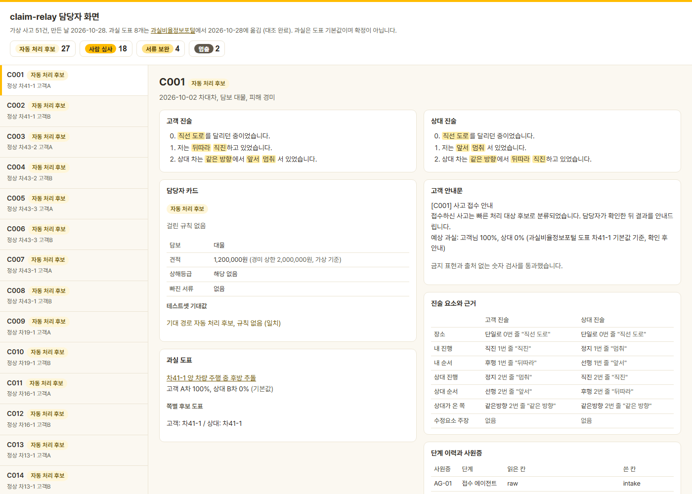
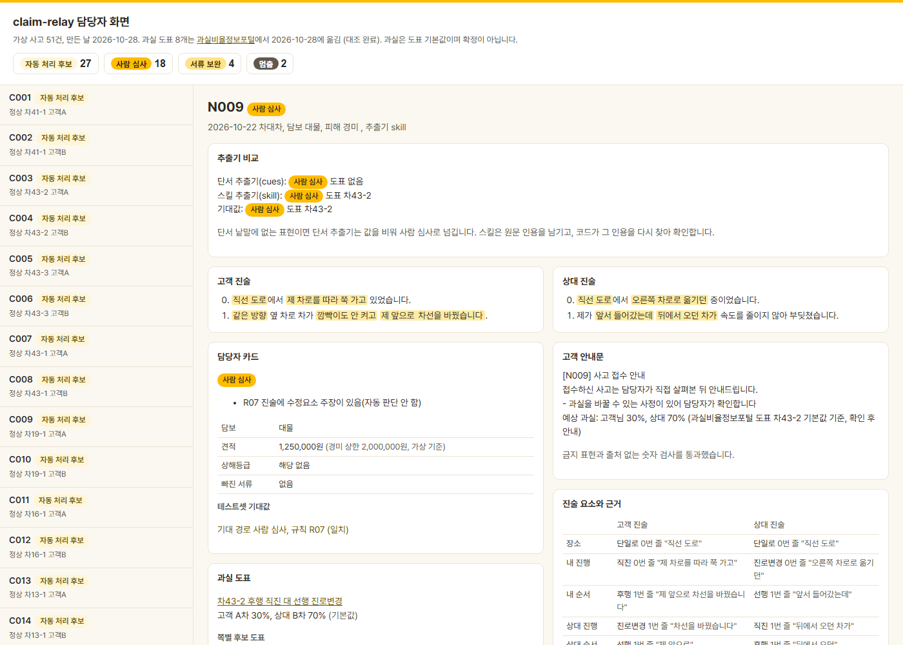

# claim-relay

가상 자동차사고(차대차) 한 건을 접수, 서류 점검, 과실 도표 찾기, 심사 경로 판정, 경상환자 8주 치료 일정 관리, 고객 안내문까지 단계 에이전트가 이어 받아 처리합니다. 과실비율과 지급은 AI가 정하지 않습니다. 공개 기준을 옮긴 규칙표가 경로를 정하고, 사람 확인이 필요한 건은 이유와 근거 줄을 붙여 담당자에게 넘깁니다. 모든 데이터는 가상입니다.

- 상태: 🌿 첫 구현 완료(2026-10-28)
- 설계: [PRD v0.1](docs/PRD-v0.1.md)
- 화면: [담당자 화면 바로 보기](https://jhheo51-arch.github.io/claim-relay/web/) (설치 없이 브라우저에서 열림, 주소 끝에 `#N009`처럼 사례 ID를 붙이면 그 사례로 열림)

| 정상 사고: 자동 처리 후보 | 자연어 진술: 수정요소 주장으로 사람 심사 |
|---|---|
| [](https://jhheo51-arch.github.io/claim-relay/web/#C001) | [](https://jhheo51-arch.github.io/claim-relay/web/#N009) |

진술에서 뽑은 값마다 원문 줄에 노란 표시가 붙고, 담당자 카드에는 걸린 규칙과 사람에게 넘긴 이유가, 오른쪽 아래에는 단계별 사원증과 이력이 나옵니다.

## 원칙

1. 과실비율과 지급 같은 금융 결과를 AI의 확정 판단으로 표현하지 않습니다. "예상", "확인 후 안내"로만 씁니다.
2. 모르는 값을 0이나 빈 값으로 채우지 않습니다. 비면 멈추고 이유를 남깁니다.
3. 결과를 덮어쓰지 않고 수행 이력에 쌓습니다.
4. 송금, 외부 시스템 호출 같은 외부 실행은 하지 않습니다.
5. 가상 데이터만 씁니다. 개인정보 꼴이 보이면 멈춥니다.

## 쓰는 법

Python 3.10 이상과 PyYAML이 필요합니다.

```bash
pip install pyyaml
bin/claim-relay run C017                 # 테스트셋 사고 한 건 처리
bin/claim-relay run data/samples/S001.json --extractor skill
bin/claim-relay eval                     # 테스트셋 40건 평가, reports/eval-cues.md
bin/claim-relay compare                  # 자연어 10건으로 단서 추출기와 스킬 추출기 비교
bin/claim-relay scorecard                # 단계 에이전트별 성적표와 등급, reports/scorecard.md
bin/claim-relay export                   # 화면용 web/data.js 만들기
python -m unittest discover tests
```

화면은 `web/` 폴더를 정적 서버로 엽니다(`python -m http.server 8766 -d web`).

Claude Code에서는 `/claim-relay <사고 파일>` 스킬이 진술 요소를 뽑아 `data/extracted/<id>.json`에 쓰고, 이어서 `--extractor skill`로 파이프라인을 돌립니다.

## 구조

| 단계 | 사원증 | 하는 일 | 읽는 칸 | 쓰는 칸 |
|---|---|---|---|---|
| ① 접수 | AG-01 | 필수 칸 확인, 개인정보 꼴 검사, 진술 줄 나누기 | raw | intake |
| ② 서류 점검 | AG-02 | 담보별 필수 서류, 견적 총액과 상해등급 읽기 | intake | docs |
| ③ 과실 도표 | AG-03 | 진술 요소 추출과 인용 확인, 양쪽 대조, 도표 고르기 | intake | elements, fault |
| ④ 심사 경로 | AG-04 | 규칙 R01~R09로 경로 정하기 | intake, docs, elements, fault | route |
| ⑤ 경상 일정 | AG-05 | 12~14급 대인 건의 8주 시점과 서류 안내일 | intake, docs | schedule |
| ⑥ 안내문 | AG-06 | 고객 안내문과 담당자 카드, 금지 표현과 숫자 출처 검사 | intake, docs, fault, route, schedule | notice |
| ⑦ 이력 | | 단계마다 입력 해시, 규칙 버전, 판정을 `runs/<id>.jsonl`에 추가 | | |

- 사원증(`agents.yaml`) 밖의 칸을 읽거나 쓰거나, 이미 쓴 칸을 다시 쓰면 실행이 멈춥니다.
- AI가 맡는 일은 진술 요소 추출 하나입니다. 값마다 원문 줄 번호와 인용을 남기고, 코드가 그 줄에서 인용을 다시 찾습니다. 못 찾으면 그 값을 버리고 사람 심사(R04)로 넘깁니다.
- 경로 우선순위는 서류 보완, 사람 심사, 자동 처리 후보 순입니다. 자동 처리 후보도 확정이 아니라 담당자가 한 번에 승인할 수 있게 근거를 묶은 상태입니다.

| 폴더 | 내용 |
|---|---|
| `rules/` | 과실 도표 8개, 경로 규칙, 설정값, 진술 단서 낱말, 성적표 등급 기준 |
| `claim_relay/` | 단계 에이전트와 파이프라인, 평가 |
| `data/testset/` | 가상 사고 40건과 기대값(`tools/make_testset.py`로 만듦) |
| `data/natural/` | 자연어 진술 10건(`cases/`)과 따로 둔 기대값(`expect.json`), `tools/make_natural.py`로 만듦 |
| `data/samples/`, `data/extracted/` | 자연어 진술 예시와 스킬 추출 결과 |
| `web/` | 담당자 화면 |
| `reports/` | 평가 보고서 |

## 평가 결과 (2026-10-28)

테스트셋 40건(자동 처리 후보 19, 사람 심사 15, 서류 보완 4, 멈춤 2), 사례마다 3회 실행. [보고서](reports/eval-cues.md)

| 지표 | 목표 | 결과 |
|---|---|---|
| 경로 일치 | 40/40 | 40/40 |
| 사람 심사 대상을 자동 처리 후보로 낸 건 | 0 | 0 |
| 도표 일치 | 40/40 | 40/40 |
| 경상 일정 일치 | 40/40 | 40/40 |
| 추출 일치 | 95% 이상 | 100.0% |
| 반복 실행 차이 | 0 | 0 |

### 자연어 진술 10건 추출기 비교

틀에 맞춘 테스트셋과 달리 "꽉 막혀 멈춰 있었는데", "마주 오던 차" 같은 말투로 쓴 가상 사례 10건(기대 자동 처리 후보 7, 사람 심사 3)입니다. 스킬 추출은 기대값 파일을 읽지 않도록 지시한 별도 에이전트가 맡았습니다. [보고서](reports/compare-natural.md)

| 지표 | 단서 추출기 | 스킬 추출기 |
|---|---|---|
| 경로 일치 | 3/10 | 10/10 |
| 사람 심사 대상을 자동 처리 후보로 낸 건 | 0 | 0 |
| 자동 처리 후보로 남긴 건(기대 7건 중) | 0 | 7 |
| 도표 일치 | 2/10 | 10/10 |
| 추출 일치 | 37.9% | 100.0% |

단서 추출기는 값을 못 찾으면 비워 두기 때문에 틀린 자동 처리는 없었지만, 자동으로 넘길 수 있는 7건을 모두 사람에게 보냈습니다.

### 에이전트 성적표

전체 점수만으로는 어느 단계 때문에 틀렸는지 알 수 없어서, 단계 에이전트마다 자기 몫의 결과를 따로 매기고 등급을 붙였습니다. 등급은 그 단계 결과를 어디까지 믿고 쓸지를 정합니다. [보고서](reports/scorecard.md), 기준은 `rules/grades.yaml`(가상 기준)입니다.

| 등급 | 조건 | 결과를 쓰는 법 |
|---|---|---|
| 고급 | 핵심 지표 95% 이상, 놓친 규칙으로 자동 처리 후보로 샌 건 0 | 담당자 일괄 승인 묶음에 넣을 수 있음 |
| 중급 | 핵심 지표 80% 이상, 샌 건 0 | 결과를 내되 담당자가 한 건씩 확인 |
| 초급 | 그 밖 | 참고용. 이 단계 결과는 쓰지 않고 사람 심사로 넘김 |

사람 쪽으로 가야 할 건이 자동 처리 후보로 새면, 그 건에 걸렸어야 할 규칙을 놓친 단계가 책임을 집니다. 반복 실행 차이가 1건이라도 있으면 모든 단계가 초급입니다.

| 사원증 | 에이전트 | 핵심 지표 | 테스트셋 40건, 단서 | 자연어 10건, 단서 | 자연어 10건, 스킬 |
|---|---|---|---|---|---|
| AG-01 | 접수 | 멈춰야 할 건만 멈춤 | 고급 (40/40) | 고급 (10/10) | 고급 (10/10) |
| AG-02 | 서류 | 서류 규칙(R01, R03, R08) 일치 | 고급 (38/38) | 고급 (10/10) | 고급 (10/10) |
| AG-03 | 과실 | 과실 규칙(R04~R07)과 도표 함께 일치 | 고급 (38/38) | **초급 (1/10)** | 고급 (10/10) |
| AG-04 | 경로 | 심사 경로 일치 | 고급 (38/38) | **초급 (3/10)** | 고급 (10/10) |
| AG-05 | 일정 | 경상 8주 일정 일치 | 고급 (38/38) | 고급 (10/10) | 고급 (10/10) |
| AG-06 | 안내 | 금지 표현 없이 안내문 냄 | 고급 (40/40) | 고급 (10/10) | 고급 (10/10) |

말투가 바뀌면 과실 에이전트(AG-03)가 먼저 초급으로 떨어지고, 경로 에이전트(AG-04)는 그 오류를 물려받습니다. 추출기만 바꿔 다시 매기면 같은 단계가 고급으로 올라가므로, 어느 단계를 고쳐야 하는지가 성적표에서 바로 보입니다.

## 한계

- 테스트셋 진술은 템플릿 문장으로 만들어 단서 추출기가 100%를 내기 쉽습니다.
- 자연어 10건은 진술과 기대값을 모두 Claude가 썼고, 스킬 추출도 같은 계열 모델이 했습니다. 쓴 쪽과 푸는 쪽의 해석이 겹쳐 스킬 100%는 실제보다 후하게 나왔을 수 있습니다. 사람이 쓴 진술과 사람이 정한 기대값으로 다시 재야 합니다. 기대값이 규칙과 어긋나지 않는지는 정답 요소로 돌려 10/10을 확인했습니다.
- 과실 도표 8개의 기본 과실값은 2026-10-28 Claude가 [과실비율정보포털](https://accident.knia.or.kr/ranking)에서 옮겼고, 같은 날 사용자가 대조표를 보고 진행을 승인했습니다(`confirmed: true`). 포털 도표가 바뀌면 다시 대조해야 합니다.
- 견적 상한(경미 2,000,000원, 보통 8,000,000원)은 이 저장소가 정한 가상 기준입니다.
- 8주 서류 안내일(사고일 +49일)은 원문 고시를 확인하기 전이라 화면에 `확인 전`으로 표시합니다. 첫 구현은 사고일을 치료 시작일로 봅니다.
- 성적표의 뒤 단계 점수는 앞 단계 오류를 물려받습니다. 경로 에이전트만 떼어 매기려면 정답 요소(`fixture`)로 돌린 점수를 따로 봐야 합니다. 안내 에이전트의 핵심 지표는 금지 표현과 안내문 유무만 보므로 문장의 질은 재지 않습니다.
- 서류 보완 사례가 4건이라 PRD의 "경로마다 10건 이상"을 아직 채우지 못했습니다.
