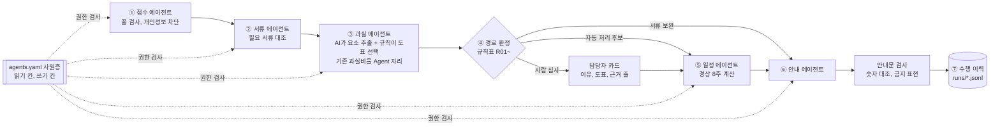

# claim-relay PRD v0.1: 자동차보험 청구 릴레이 에이전트

- 작성일: 2026-10-28
- 상태: 🌱 설계 확정, 구현 전. 사용자가 스무고개를 생략하고 조사 내용으로 결정하기로 정함(2026-10-28)
- 이름: `claim-relay`. 단계 에이전트가 바통을 넘기듯 사고 한 건을 이어 처리한다는 뜻
- 실행 환경: ① 터미널 `bin/claim-relay`(판정과 검사는 Python 규칙) ② Claude Code 스킬 `/claim-relay`(진술 읽기와 안내문) ③ 정적 웹 화면 `web/`(가상 사고 결과 보기, API 키 없이 동작)
- 공통 원칙: [README 원칙](../README.md#원칙)

## 1. 한 문장 정의

claim-relay는 가상 자동차사고(차대차) 한 건을 받아 사고 접수, 서류 점검, 과실 도표 찾기, 심사 경로 판정, 경상환자 치료 일정 관리, 고객 안내문까지 한 흐름으로 잇는 에이전트입니다. 과실비율과 지급을 AI가 정하지 않습니다. 경로는 공개 기준을 옮긴 규칙표가 정하고, 사람 확인이 필요한 건은 이유와 근거 줄을 붙여 사람에게 넘깁니다. 사고와 고객은 모두 가상입니다.

## 2. 해결할 문제

자동차보험 청구는 사고 접수, 과실 산정, 대물과 대인 처리, 치료비 관리, 고객 안내가 서로 다른 담당자와 시스템에서 이어집니다. 단계 사이에서 고객은 서류 보완 요청이나 과실 안내를 늦게 받고, 왜 늦는지 모릅니다. 보험사는 이견 없는 단순 사고에도 같은 확인을 되풀이하고, 경상환자 장기 치료처럼 손해율을 끌어올리는 건은 늦게 알아챕니다. 반대로 AI에 판단을 맡기면 틀렸을 때 누가 무엇을 근거로 확인했는지 설명하기 어렵습니다.

사용자 쪽 문제도 있습니다. 사용자는 손해보험사 AI/데이터 직무에 지원했고(2026-10-28), 보험업 실무 경험이 없습니다. 면접에서 "AI 에이전트를 현업에 어떻게 들일지"를 말이 아니라 직접 만든 흐름으로 보여 줄 근거가 필요합니다.

### 근거

- 2026년 상반기 자동차보험 보험손익은 1,848억 원 적자로 6년 만에 적자로 돌아섰고, 대형 4사 누적 손해율은 84.5%로 1.9%p 올랐습니다. 원인으로 과잉 진료에 따른 보험금 누수가 꼽혔습니다([세이프타임즈 경제](https://sateconomy.co.kr/news/view/1065573661985195), [세이프타임즈 경제](https://sateconomy.co.kr/news/view/1065583131762424), 2026-10-28 확인).
- 대형 손해보험사 상반기 순이익 감소 원인으로도 자동차보험 적자 전환이 꼽혔습니다([SBS Biz](https://biz.sbs.co.kr/amp/article/20000334604), 2026-10-28 확인).
- 2026-09-10부터 상해등급 12~14급 경상환자가 8주를 넘겨 치료받으려면 진단서와 치료 필요성 자료를 내고, 자동차손해배상진흥원 심사를 거쳐야 합니다(8주룰). 제출 기한은 "사고 후 7주 이내"라는 보도가 있으나 원문 고시는 확인하지 못했습니다([SBS Biz](https://biz.sbs.co.kr/amp/article/20000327421), [비즈워치, 2026-09-02](https://news.bizwatch.co.kr/article/finance/2026/09/02/0015), 2026-10-28 확인).
- 과실비율 인정기준은 손해보험협회가 공개하고(과실비율정보포털 accident.knia.or.kr), 사고 유형과 장소, 양측 진행 경로로 도표를 찾은 뒤 수정요소를 더합니다. 전체 사고의 약 80%는 일방 과실 등으로 이견 없이 처리된다는 설명이 있습니다([위키독스 정리 글](https://wikidocs.net/blog/@Insight_Lab/21756/), 블로그라 참고만, 2026-10-28 확인).
- 업계에는 이미 과실비율 AI 에이전트가 있습니다. 2025-09 도입된 사례는 직원이 협회 기준을 직접 검색하던 일을 에이전트가 과실도표 찾기와 예상 과실비율 안내로 바꿨습니다([헤럴드경제](https://www.heraldk.com/article/2025091715544216127), [한국경제](https://www.hankyung.com/article/2025100196641), 2026-10-28 확인).
- 같은 회사는 2026-09 에이전트 6개에 사원번호를 주고 업무 범위, 접근 권한, 수행 이력을 관리하며([세이프타임즈 경제](https://sateconomy.co.kr/news/view/1065591402935862)), 목표를 "청구 접수부터 심사, 판단, 고객 안내까지 연결"로 밝혔습니다([다음 뉴스, 2026-05-19](https://v.daum.net/v/20260519163958538)). 둘 다 2026-10-28 확인.
- 손해보험협회도 과실비율 심의에 생성형 AI를 도입해 비슷한 결정례 3건과 판례를 보여 주려 합니다([이투데이](https://www.etoday.co.kr/news/view/2610878), 2026-10-28 확인).
- 업계 우려로 AI 판단의 신뢰성, 개인정보, 설명 가능성이 꼽힙니다([비즈워치, 2025-08](https://news.bizwatch.co.kr/special/2025/view/202508250034), 2026-10-28 확인).
- 사용자는 ARVIS 도입 때 반대 6명의 걱정(틀린 답, 보안)을 "규정 문서만 넣고 개인정보는 넣지 않는다"는 원칙으로 바꿔 도입했습니다(경험 장부 E01, 2026-10-28 확인). 이 저장소는 같은 원칙을 자동차 보상에 옮깁니다.

### 해결안 선택

| 대안 | 좋은 점 | 고르지 않은 이유 |
|---|---|---|
| 실손의료보험 청구 | 청구 자동심사 사례가 많음 | 규칙표를 가상 약관으로 지어내야 함. 손해보험사 이익 감소의 직접 원인이 아님 |
| 과실비율 산정만 더 잘하기 | 범위가 작음 | 업계에 이미 운영 중인 에이전트와 같은 일. 앞뒤 단계를 잇는 문제에 답하지 못함 |
| LLM 하나가 사고를 읽고 과실과 지급까지 판단 | 만들기 가장 쉬움 | 같은 사고에 다른 답이 나올 수 있고 금융 판단을 AI가 확정함([원칙](../README.md#원칙) 1번) |
| 차대차 사고, 공개 기준을 옮긴 규칙표, AI는 읽기와 문장만 | 규칙 근거가 공개 기준이라 지어낸 값이 아님. 과실 단계를 기존 과실비율 에이전트 자리에 끼우는 구조라 겹침을 설명할 수 있음 | 도표를 일부만 옮김. 이 한계를 7장과 9장에 적음 |

고른 방법: 마지막 줄입니다.

## 3. 대상 사용자

1차 사용자는 사용자 본인입니다. 면접에서 이 흐름을 화면으로 보여 주고, 사람 확인 지점을 어디에 왜 두었는지 설명합니다.

화면이 가정하는 사용자는 두 명입니다.

- **보상 담당자(가상)**: 사람 심사로 넘어온 사고를 받습니다. 넘어온 이유, 걸린 규칙, 찾은 과실 도표 번호, 근거가 된 진술 줄을 한 화면에서 봅니다.
- **사고 고객(가상)**: 서류 보완 요청, 예상 과실 안내(확정 아님), 경상 치료 8주 전 서류 안내를 받습니다.

## 4. 확정 사항

| 번호 | 질문 | 결정 |
|---:|---|---|
| 1 | 저장소와 문서 | 별도 저장소 `claim-relay`, PRD v0.1. 형식은 새록이 PRD 형식을 따르고 새록 검토관으로 검사(2026-10-28 사용자 결정) |
| 2 | 상품 범위 | 가상 개인용 자동차보험, 차대차 사고. 담보는 대물과 대인(경상 12~14급). 자차, 차대사람, 중상은 사람 심사로만 넘김 |
| 3 | 규칙 근거 | 과실 도표는 과실비율정보포털의 차대차 도표 중 자주 나는 유형 8개만 옮김(교차로, 차로 변경, 추돌 등). 도표마다 번호, 원문 링크, 옮긴 날짜. 기본 과실값은 2026-10-28 Claude가 포털 도표 화면에서 옮겼고 사용자 대조 전이라 `rules/fault-charts.yaml`에 `confirmed: false`로 둠. 사용자가 대조하면 `true`로 바꿈 |
| 4 | 입력 | 사고 접수 JSON 1개(일시, 장소 유형, 양측 진행 경로, 신호, 양측 진술 글, 피해 정도) + 첨부 서류 글 파일(수리 견적서, 진단서, 진료비 내역). 블랙박스 영상과 이미지는 다루지 않음 |
| 5 | 단계 | ① 접수 ② 서류 점검 ③ 과실 도표 찾기 ④ 심사 경로 판정 ⑤ 경상 치료 일정 관리 ⑥ 고객 안내문 ⑦ 수행 이력. 단계마다 에이전트 하나 |
| 6 | AI가 하는 일 | 진술 글에서 사고 요소 뽑기(값마다 원문 줄 번호), 안내문 문장. 이 둘뿐 |
| 7 | 규칙이 하는 일 | 서류 대조, 요소로 도표 고르기, 양측 진술 비교, 금액 검산, 경로 판정, 8주 일정 계산, 안내문 숫자 대조. 같은 입력이면 같은 결과 |
| 8 | 심사 경로 | `자동 처리 후보`, `사람 심사`, `서류 보완`. 판정마다 걸린 규칙 ID와 이유 |
| 9 | 사람에게 넘기는 기준 | 양측 진술이 사고 요소에서 엇갈림, 옮긴 도표 8개에 없는 유형, 수정요소 판단이 필요함, 중상이나 차대사람, 견적과 사고 정도 불일치, AI가 뽑은 값의 원문 줄을 찾지 못함 중 하나라도 걸리면 사람 심사 |
| 10 | 자동 처리 후보의 뜻 | 확정이 아님. 담당자가 한 번에 승인할 수 있게 근거를 묶은 상태. 안내문은 "예상 과실", "확인 후 안내"로만 씀 |
| 11 | 과실 단계의 자리 | ③ 단계는 기존 과실비율 에이전트가 하는 일과 같은 자리라고 화면에 적음. 이 저장소는 그 앞뒤를 잇는 구조를 보여 주는 것이 목적 |
| 12 | 8주룰 | 경상 12~14급 대인 건은 치료 시작일(첫 구현은 사고일을 치료 시작일로 봄)로 8주 시점과 서류 안내 시점을 계산해 담당자 일정에 올리고 고객 안내문을 미리 만듦. 서류 기한(7주)은 원문 확인 전이라 설정값으로 두고 화면에 `확인 전` 표시 |
| 13 | 에이전트 사원증 | 단계 에이전트마다 업무 범위, 읽기 칸, 쓰기 칸을 `agents.yaml`에 적음. 권한 밖 칸을 읽거나 쓰면 실행을 멈춤 |
| 14 | 개인정보 | 가상 데이터만 받음. 주민등록번호, 차량번호, 전화번호 꼴이 보이면 멈춤. AI에는 가명 ID만 넘김 |
| 15 | 수행 이력 | 단계마다 입력 해시, 규칙 버전, 판정, 걸린 규칙, 걸린 시간을 `runs/<사고 ID>.jsonl`에 남김 |
| 16 | 평가 테스트셋 | 가상 사고 40건. 사람이 정한 기대 경로, 기대 도표 번호, 기대 누락 서류를 함께 둠. 경로마다 10건 이상, 함정(진술 엇갈림, 도표 밖 유형, 견적 과다, 8주 경계일) 포함 |
| 17 | 모델 | 세션 모델 하나. 판정은 모델을 바꿔도 같아야 함 |
| 18 | 화면 | 정적 웹 `web/`: 사고 목록, 단계 진행, 사람 심사 카드, 8주 일정판, 안내문 미리보기, 이력. 노트북 하나로 면접에서 보여 줄 수 있게 |
| 19 | 저장 | 가상 데이터는 `data/`, 결과는 `runs/`. 모두 이 저장소 안 |
| 20 | 일정 | 첫 구현은 2026-10-28에 앞당겨 마침(사용자 요청). 자연어 진술 사례 늘리기와 도표 대조는 서류 제출(2026-11-01) 뒤. 면접 일정이 나오면 다시 맞춤 |

## 5. 차별점과 구조

### 5.1 구조도

### 5.2 차별점

| 차별점 | 무엇이 다른가 | 근거 |
|---|---|---|
| 판정은 규칙, AI는 읽기와 문장 | 같은 사고에 언제나 같은 경로. AI가 바뀌어도 판정은 그대로 | 업계 우려(신뢰성, 설명 가능성) |
| 넘김 카드 | 자동 처리율보다 "왜 사람에게 넘겼는지"를 규칙 ID, 도표 번호, 진술 줄로 남김 | 단순 사고 자동 처리는 이미 흔함 |
| 공개 기준 근거 | 과실 도표는 손해보험협회 공개 기준을 옮기고 번호와 링크를 붙임. 지어낸 규칙이 아님 | 과실비율 인정기준 |
| 사원증을 실행 규칙으로 | 에이전트 사원번호 제도의 업무 범위와 접근 권한을 `agents.yaml`로 옮기고, 어기면 실행을 멈춤 | 2026-09 업계 사례 |
| 8주룰 일정 관리 | 시행 두 달 된 제도를 담당자 일정과 고객 사전 안내로 연결. 손해율 문제와 고객 경험을 함께 다룸 | 8주룰, 자동차보험 적자 |
| 평가 테스트셋과 반복 실행 | 40건 기대값과 3회 반복 동일성으로 성능을 숫자로 보고 | 보험 전용 AI 테스트셋 흐름 |
| ARVIS 원칙 | 반대하는 현업의 걱정(오답, 보안)을 권한과 확인 지점으로 바꾼 경험을 그대로 설계 원칙으로 씀 | 경험 장부 E01 |

## 6. 해결책: 사고 흐름

### 6.1 접수 `bin/claim-relay run <사고 파일>` 또는 `/claim-relay <사고 파일>`

- 사고 JSON에서 사고 ID, 가명 고객 ID, 일시, 장소 유형, 양측 진행 경로, 신호, 진술, 피해 정도, 첨부 목록을 읽습니다.
- 칸이 비었거나 꼴이 틀리면 0이나 빈 값으로 채우지 않고 `접수 오류`로 멈춥니다([원칙](../README.md#원칙) 2번). 개인정보 꼴 검사를 이 단계에서 합니다.

### 6.2 서류 점검

- 담보와 피해 정도별 필요 서류 표와 첨부 목록을 대조합니다. 하나라도 빠지면 경로는 `서류 보완`입니다.

### 6.3 과실 도표 찾기

- AI가 양측 진술에서 사고 요소(장소, 각자 진행 경로, 신호, 차로 변경 여부 등)를 뽑고 값마다 `(진술, 줄 번호)`를 붙입니다. 원문 줄에서 값을 다시 찾지 못하면 `근거 없음`입니다.
- 규칙이 요소 조합으로 도표 8개 중 하나를 고릅니다. 양측 요소가 엇갈리거나 맞는 도표가 없으면 고르지 않고 사람 심사로 넘깁니다.
- 기본 과실값은 옮긴 값이 있을 때만 "예상 기본 과실(수정요소 반영 전)"로 보여 줍니다.

### 6.4 심사 경로 정하기

- `rules/claim-rules.yaml`의 규칙을 정해진 순서로 적용합니다. 규칙마다 ID, 조건, 결과 경로, 고객용 사유 틀, 담당자용 설명을 둡니다.
- 판정은 `서류 보완` > `사람 심사` > `자동 처리 후보` 순으로 강한 쪽을 따릅니다.

### 6.5 경상 치료 일정

- 대인 경상 12~14급 건은 치료 시작일로 서류 안내일(설정값, 기본 7주)과 8주 도래일을 계산합니다.
- 일정판에 오늘 기준 남은 날을 보여 주고, 안내일에 쓸 고객 안내문을 미리 만듭니다.

### 6.6 고객 안내문

- AI가 경로별 틀에 맞춰 씁니다. 날짜, 도표 번호, 빠진 서류 이름, 예상 과실은 판정 결과에서 그대로 끼워 넣습니다.
- 스크립트가 안내문 속 숫자와 이름이 판정 결과와 같은지, 금지 표현("과실이 확정", "지급되었습니다", "거절")이 없는지 봅니다. 다르면 안내문을 내보내지 않습니다.

### 6.7 수행 이력과 평가 `bin/claim-relay eval`

- 단계 에이전트는 `agents.yaml` 사원증을 따르고, 수행 이력은 화면의 '이력' 탭과 채점에 함께 씁니다.
- `eval`은 테스트셋 40건으로 경로, 도표 번호, 누락 서류, 추출 값, 안내문 검사, 8주 일정 계산을 채점하고, 3번 돌려 판정이 바뀌면 실패로 둡니다.

## 7. 성공 지표

- 심사 경로 일치: 테스트셋 40건 중 기대 경로와 같은 비율 100%
- 사람 심사로 가야 할 건을 `자동 처리 후보`로 낸 건수: 0건
- 과실 도표 번호 일치: 도표를 고른 건 중 100%, 고르지 말아야 할 건에서 고른 건수 0건
- 진술 요소 추출: 뽑을 칸 기준 일치율 95% 이상, `근거 없음` 표시 없이 틀린 값 0건
- 8주 일정 계산과 안내문 검사: 불일치 0건
- 반복 실행: 3회 판정 차이 0건
- 면접 대비: "틀리면 누가 책임지나", "개인정보는", "기존 과실비율 에이전트와 뭐가 다른가"에 화면의 어느 칸으로 답할지 정한 답변 카드 3개 이상

### 측정과 회고

- 2026-11-09에 첫 버전 기준으로 위 지표를 잽니다. 면접이 끝나면 받은 질문과 화면이 답했는지 적습니다.
- 결과에 따른 다음 추진
  - 경로나 도표 일치가 100%가 아님: 틀린 건을 규칙 문제와 기대값 문제로 나눠 고칩니다.
  - 추출 일치율이 95% 아래: 틀린 칸 종류를 모아 진술 틀이나 프롬프트를 고치고, 그래도 안 되면 그 칸을 사람 확인 칸으로 돌립니다.
  - 면접에서 화면이 답하지 못한 질문: 다음 단계 후보로 9장에 옮깁니다.
- 회고 결과는 이 PRD와 README 할 일에 날짜와 함께 남깁니다.

## 8. 가정과 위험

| 가정과 위험 | 대응 |
|---|---|
| 옮긴 과실 도표 값이 틀릴 수 있다 | 도표마다 번호, 링크, 옮긴 날짜. 사용자가 포털에서 직접 옮기기 전에는 `확인 전`이고 화면에 값을 보여 주지 않음 |
| 가상 테스트셋 100%가 실제 성능처럼 읽힐 수 있다 | 규칙으로 만든 데이터를 규칙으로 맞힌 것이라고 지표 옆에 적음. 실제 성능 주장은 하지 않음 |
| 기존 과실비율 에이전트를 베낀 것으로 보일 수 있다 | ③ 단계를 기존 에이전트 자리로 명시하고, 차별점을 앞뒤 연결과 넘김 카드로 둠(5.2절) |
| 8주룰 세부(서류 기한, 대상)가 보도와 다를 수 있다 | 기한은 설정값, 화면에 `확인 전`. 자배원이나 국토교통부 원문을 확인하면 고침 |
| AI가 진술에 없는 요소를 지어낼 수 있다 | 값마다 원문 줄, 다시 찾지 못하면 `근거 없음`, 경로는 사람 심사 |
| 안내문이 과실이나 지급을 확정한 것처럼 읽힐 수 있다 | 금지 표현 검사, "예상", "확인 후 안내" 틀([원칙](../README.md#원칙) 1번) |
| 실제 개인정보가 섞일 수 있다 | 개인정보 꼴이 보이면 멈춤. 저장소에는 가상 데이터만 |
| 면접 전에 다 만들지 못할 수 있다 | 접수, 서류 점검, 경로 판정, 안내문 검사, 일정, 화면 순으로 만들고, 화면 전까지만 끝나도 터미널로 보여 줌 |

## 9. 이번 단계에서 만들지 않는 것

- 실제 사고, 실제 고객 정보, 보험사 내부 기준
- 블랙박스 영상, 사고 사진, 서류 이미지 OCR
- 과실비율 확정과 수정요소 자동 판단(사람 심사로 넘김)
- 자차, 차대사람, 중상 사고의 처리(사람 심사로만 넘김)
- 지급 확정, 송금, 외부 시스템 연동, 자배원 심사 요청 자동화
- 보험사기 점수 모델
- 실손의료보험(2장 해결안 선택)

## 10. 다음에 할 일

- 만든 뒤 경험 장부에 새 경험으로 더하고(`한 일`과 `설계안` 구분), 지원 포트폴리오에 넣을지 사용자가 정합니다.
- 자동차보험 용어(대물, 대인, 과실비율, 수정요소, 상해등급, 손해율) 풀이를 README에 붙일지 정합니다.
